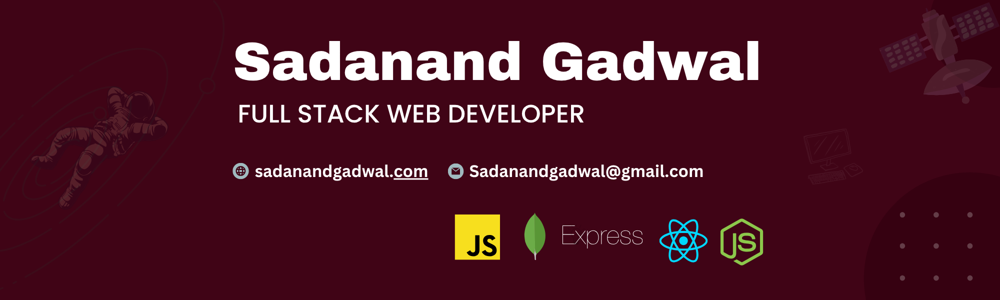

  

# 💫 About Me

Frontend-focused **Full Stack Developer** with **3+ years of experience** building scalable ERP applications, complex dashboards, interactive reports and performance-optimized web apps with **React.js** and modern frontend tooling.

🔭 Currently working as a **Full Stack Developer at [Digital Think Technologies LLP](https://knsgroup.in/)**, Bangalore — building real estate ERP modules with React.js, Node.js, Express.js & MongoDB  
🎨 I turn Figma designs into responsive, pixel-perfect interfaces using Material UI, Tailwind CSS & SCSS  
📊 I build data visualizations with Chart.js and Syncfusion Gantt Chart  
🧑‍💻 All my projects and experience are available at https://sadanandgadwal.com  
💬 Ask me about React.js | Next.js | Redux | JavaScript  
📍 Based in Bangalore, Karnataka, India  
📫 How to reach me: sadanandgadwal@gmail.com 

## 💼 Experience

**Full Stack Developer** — Digital Think Technologies LLP, Bangalore · *Sep 2023 – Present*
- Develop and maintain scalable ERP modules for real estate management using React.js, Node.js, Express.js and MongoDB
- Resolve critical application issues, optimize API calls, and build complex dashboards and reports as a Senior Frontend Developer
- Implement authentication, CRUD operations, REST API integrations and complex business workflows

**Front-end Developer** — The DeveLearn Institute, Maharashtra · *Oct 2022 – Jul 2023* · [Certificate](https://drive.google.com/file/d/1BVZ0mmlvyniuoqZuSpdFRG6jVtHaa817/view)
- Built responsive UIs with Tailwind CSS and Material UI, with cross-browser compatibility and performance optimization

**React Developer** — Shivila Technologies, West Bengal · *Dec 2021 – Apr 2022* · [Certificate](https://drive.google.com/file/d/12huNvYPvbEGl3ss3BXyyGwVQOyyQVuyp/view)
- Developed reusable React.js components and implemented React Router for navigation and interactivity

## 🚀 Featured Projects

| Project | Description | Tech |
|---|---|---|
| [**KNS Connect**](https://knsconnect.in/) | Real estate ERP platform with dashboards, dynamic reports and Gantt-based project scheduling. Lazy loading & code splitting improved page load speed by **30%**. | React.js, Redux, Material UI, SCSS, Chart.js, Syncfusion Gantt |
| [**KNS Website**](https://knsgroup.in/) | Responsive, SEO-optimized real estate website with touch-friendly carousels and Google Analytics. | React.js, Bootstrap, Swiper.js, SEO |
| [**Vilcart**](https://www.vilcart.in/) | Feature-rich web app with dynamic product categories, reusable components and smooth animations. | React.js, Redux, Tailwind CSS, SCSS, Framer Motion, Swiper.js |

## 🌐 Socials:
      

# 💻 Tech Stack:

**Languages & Frontend** 
       

**State, Forms & UI** 
        

**Backend & Database** 
   

**Tools, Hosting & Analytics** 
          

## 🎓 Education

- **Master of Computer Applications (MCA)** — Central University of Karnataka · *2021 – 2023* · CGPA: 7.66
- **Bachelor of Computer Applications (BCA)** — Sharnbasva University of Karnataka · *2018 – 2021* · CGPA: 8.59

## 🏆 Achievements & Certifications

- 📜 [The Complete 2023 Web Development Bootcamp](https://drive.google.com/file/d/1sth5kpYDNNg22_i8BeW8ayPCMZomC4vY/view?usp=sharing) — Udemy
- 🤖 Getting Started with Deep Learning — NVIDIA Deep Learning Institute (July 2022)

# 📊 GitHub Stats:
 
 

---

<!-- Proudly created with GPRM ( https://gprm.itsvg.in ) -->
